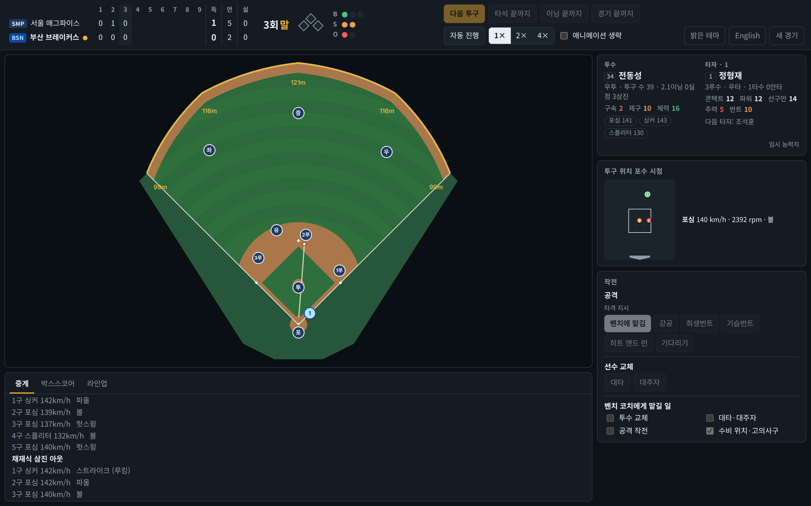

# Baseball Manager

야구 구단 경영 시뮬레이션 게임. 장르와 깊이는 Football Manager를 기준으로 삼되, 이름·UI·데이터·문구는 전부 새로 만드는 독자 작품이다. 선수와 구단은 모두 가상이다.

경기는 확률표가 아니라 물리 계산으로 진행한다. 투구 하나마다 공의 비행을 적분하고, 스윙(또는 번트)이 만든 배트-공 충돌에서 타구가 나오고, 타구의 비행·바운드와 야수·주자의 이동 시간으로 플레이 결과를 정한다.

## 현재 상태

**마일스톤 3: 선수 능력치 체계 (진행 중).** 가상 구단 두 팀의 연습 경기를 한 판 치를 수 있고, 선수마다 능력치 40개가 있다. 리그, 시즌, 이적·계약 같은 경영 부분은 아직 없다.

| 구성 요소 | 상태 |
| --- | --- |
| 물리 (`bm-physics`): 공 비행, 배트-공 충돌, 바운드·구름, 구장 | 1단계 완료 |
| 경기 엔진 (`bm-engine`): 투구·타격·수비·주루, 작전, 교체, AI 감독, 박스스코어 | 동작 |
| 세션 (`bm-session`): 경기 한 판을 명령으로 진행하고 화면용 데이터로 내보냄 | 동작 |
| 앱 (`app/`): React + PixiJS 화면, Tauri 데스크톱 셸 | 경기 화면 동작. Windows 설치 파일은 CI에서 빌드 |
| 검증 도구 (`bm-cli`): MLB 2025 기록·Statcast와 비교(리그 총량, 선수 간 분포, 능력치의 가치), 개발 서버 | 동작 |
| 월드 (`bm-world`): 선수 능력치, 능력치 → 물리량 변환, 선수 생성 | 능력치 체계 동작 (메이저리그 수준만) |
| 리그 월드 (한·미·일): 리그·일정, 이적·계약·재정·스카우트·훈련, 세이브 | 구단 198개·구장 데이터와 불러오기, 날짜, 이름 생성 준비, 한·미·일 1군과 마이너리그의 정규 시즌 일정 생성. 수준별 선수 생성·세이브는 시작 전 |

경기 화면에서 할 수 있는 것:

- 투구 단위, 타석 단위로 진행하거나 자동 진행. 이닝·경기 끝까지는 벤치 코치가 대신 지휘
- 공격 작전: 강공, 희생번트, 기습번트, 히트 앤드 런, 기다리기, 도루 지시와 금지
- 수비 작전: 내야(정상·병살 수비·전진·코너 전진), 외야(정상·전진·후퇴), 시프트, 고의사구
- 교체: 대타, 대주자, 투수 교체, 수비 교체 (재출장 불가, 규칙에 따라 세 타자 의무 상대)
- 업무별 위임: 투수 교체, 대타·대주자, 공격 작전, 수비 위치를 벤치 코치에게 맡길 수 있음
- 규칙 선택: 한국식(ABS, 연장 11회 무승부), 북미식(승부치기 주자, 세 타자 의무 상대), 일본식(연장 12회 무승부, 시프트 자유)
- 선수 카드: 능력치 40개(타격·주루·수비·포수·투구·정신·신체)와 구종별 구속·구사율·등급. 1–20 눈금 기본, 20–80 스카우팅 눈금 전환
- 2D 탑다운 경기장, 투구 위치, 중계, 박스스코어, 라인업. 한국어 기본, 영어 전환. 어두운 테마 기본, 밝은 테마 전환



영어·밝은 테마 화면은 [`docs/screenshots/match-en-light.png`](docs/screenshots/match-en-light.png)에, 선수 카드는 [`docs/screenshots/player-card-ko-dark.png`](docs/screenshots/player-card-ko-dark.png)에 있다.

10,000경기 시뮬레이션과 2025 MLB의 비교(자세한 표는 [`docs/validation/mlb-2025.txt`](docs/validation/mlb-2025.txt)):

| 지표 | 시뮬레이션 | MLB 2025 |
| --- | --- | --- |
| 팀당 득점 | 4.30 | 4.45 |
| 타율 / 출루율 / 장타율 | .244 / .311 / .401 | .245 / .315 / .404 |
| 삼진 % / 볼넷 % / 홈런 % | 21.9 / 8.17 / 2.95 | 22.2 / 8.41 / 3.09 |
| 헛스윙 / 파울 / 인플레이 (투구 대비 %) | 11.7 / 18.2 / 18.3 | 12.1 / 18.1 / 17.6 |
| 팀당 희생번트 / 고의사구 | 0.134 / 0.108 | 0.115 / 0.114 |
| 인플레이 타구의 배트 속도 / 타구 속도 | 71.4 / 89.0 mph | 71.2 / 88.9 mph |
| 타이밍이 맞은 스윙(존 안쪽 공)의 헛스윙 / 파울 / 인플레이 % | 6.3 / 34.8 / 58.9 | 6.4 / 32.1 / 61.6 |
| 구종별 스윙당 헛스윙 %: 포심 / 싱커 / 슬라이더 / 커브 / 스플리터 | 18.9 / 17.8 / 29.8 / 33.3 / 33.0 | 21.7 / 13.9 / 33.0 / 29.9 / 36.1 |
| 구종별 평균 발사각 °: 포심 / 싱커 / 슬라이더 / 커브 / 체인지업 | 18.4 / 6.8 / 13.9 / 19.6 / 15.3 | 20.5 / 5.0 / 13.4 / 10.4 / 8.9 |

리그 평균만 맞아서는 부족하다. 선수들이 서로 얼마나 다른지도 실제와 맞아야 한다. 162경기를 치른 가상 리그의 선수별 기록과 2025 MLB(Statcast 리더보드의 규정타석 타자 145명, 선발 투수 127명)를 비교한 결과다. 전체 표는 [`docs/attributes.md`](docs/attributes.md)에 있다.

| 선수 간 표준편차 (두 시드) | 시뮬레이션 | MLB 2025 |
| --- | --- | --- |
| 타자 삼진율 / 볼넷율 (%p) | 4.9–5.5 / 2.5–2.6 | 5.7 / 3.1 |
| 타자 타율 / 장타율 | .027 / .067–.068 | .022 / .060 |
| 타자 평균 발사각 / 땅볼율 | 3.9° / 5.9%p | 4.1° / 5.8%p |
| 배트 속도와 스윙당 헛스윙률의 상관 | +0.60–0.61 | +0.69 |
| 선발 투수 삼진율 / 볼넷율 (%p) | 5.0–5.1 / 2.0 | 4.5 / 1.9 |
| 선발 투수 평균 발사각 / 땅볼율 | 4.2–4.3° / 6.4–6.6%p | 4.3° / 6.6%p |
| 선발 투수의 포심 구속 1 mph당 RA9 | −0.04 – −0.06 | −0.11 (표준오차 0.05) |

속도는 스레드 하나에서 경기당 약 7.4 ms다. 4스레드에서 초당 약 540경기이므로, MLB와 마이너리그, KBO·NPB와 2군까지 합친 한 시즌(약 13,800경기로 추정)을 전부 물리로 계산하는 데 약 26초가 걸린다.

스윙은 2025년 Statcast 배트 트래킹에서 잰 관계(접촉 깊이와 배트 방향, 스윙 평면 기울기, 타이밍이 맞은 스윙의 결과 분포)에 맞춰 만들었다. 투구 위치 오차는 같은 자료에서 잰 대로 팔 스윙 방향으로 길쭉한 타원이다. 설명은 [`docs/physics-model.md`](docs/physics-model.md) 5절에, 능력치와 물리량의 대응은 [`docs/attributes.md`](docs/attributes.md)에 있다.

맞지 않는 부분도 있다.

- 득점이 실측보다 3–4% 적다(팀당 4.26–4.30점). 같은 타구 속도에서 비거리가 3–4% 짧아 홈런이 3–5% 적다.
- **구종별 결과는 구조가 실측에 가까워졌지만 남은 차이가 있다.** 커터의 헛스윙이 적고(14.3%, 실측 21.8%) 싱커는 많다(17.8%, 13.9%). 떨어지는 공(커브·체인지업·스플리터)은 실측보다 5–9° 높게 뜬다. 변화구의 헛스윙은 높이에 따라 충분히 달라지지 않는다(존 아래는 적고 존 안은 많다).
- **투수 능력치의 가치 구성이 아직 실제와 다르다.** 구속의 실점 억제 효과가 실측의 40% 정도다(이번 보정 전에는 5분의 1 안팎). 구위(속구의 라이드)는 실측처럼 뜬공·땅볼 성향을 바꾸지만, 실측에서는 실점과 무관한데 엔진에서는 삼진을 늘려 1 표준편차당 0.08점/경기의 가치를 갖는다(지금대로 두기로 결정).
- 능력치 40개 가운데 투수 리드, 야구 지능, 승부 근성, 리더십, 팀워크, 내구성은 아직 경기 결과에 연결되지 않았다. 여러 능력치의 크기는 실측 자료가 없어 가정으로 정했다([`docs/attributes.md`](docs/attributes.md) 6절).
- 지금 연습 경기의 선수들은 규칙과 관계없이 메이저리그 수준으로 생성된다.
- 타이밍이 맞았는데도 파울이 많은 현상은 원인을 규명하지 못해 실측 비율에 맞춘 경험 규칙으로 처리했다. 구종별 인지 난이도와 '알아챈 공의 위치도 일부만 고친다'는 항도 직접 잰 값이 아니라 구종별 결과에 맞춘 값이다.

목록은 [`docs/physics-model.md`](docs/physics-model.md)의 "알려진 한계"와 [`docs/attributes.md`](docs/attributes.md) 6절에 있다.

## 빌드와 실행

엔진과 검증 도구는 Rust 1.82 이상만 있으면 된다.

```sh
cargo test --workspace                                        # 단위 테스트 99개
cargo run --release --bin bm -- game --seed 7                 # 한 경기 박스스코어
cargo run --release --bin bm -- validate --games 10000        # MLB 2025와 비교한 리포트
cargo run --release --bin bm -- players > players.csv         # 가상 리그 162경기의 선수별 기록 (선수 간 분포 확인용)
cargo run --release --bin bm -- attributes --games 8000       # 능력치 1 표준편차의 득점 가치
cargo run --release --bin bm -- bench --games 2000            # 시뮬레이션 속도
```

`validate`의 옵션: `--seed S`, `--threads T`, `--clubs K`(무작위 구단 수, 기본 300), `--style none|mlb`(AI 감독 성향), `--set 이름=값`(모델 상수를 바꿔서 실행. 이름은 `crates/bm-cli/src/tuning.rs` 참고).

앱은 Node.js 22 이상이 추가로 필요하다.

```sh
cd app && npm install

# 데스크톱 앱 (Windows는 WebView2, Linux는 webkit2gtk-4.1 필요)
npm run tauri dev          # 개발 모드
npm run tauri build        # 설치 파일 (src-tauri/target/release/bundle)

# 브라우저에서 확인 (개발·테스트용)
npm run build
cargo run --release --bin bm -- serve --static app/dist      # 저장소 루트에서, http://127.0.0.1:8787
```

Windows 설치 파일은 GitHub Actions의 "Windows app" 워크플로가 PR마다 빌드한다. 실행 결과 페이지의 Artifacts에서 `baseball-manager-windows`를 받으면 된다. 코드 서명을 하지 않았으므로 실행할 때 Windows SmartScreen 경고가 뜬다.

같은 시드와 같은 지시는 항상 같은 경기를 만든다.

## 저장소 구조

```
crates/
  bm-physics/   공 비행(항력·마그누스, RK4), 배트-공 충돌, 지면 바운드·구름, 구장 기하
  bm-engine/    투구 선택·제구, 심판/ABS, 타자 인지·스윙·번트, 수비·주루, 작전과 교체, AI 감독, 경기 진행
  bm-world/     선수 능력치(40개 + 숨김 13개), 능력치 → 엔진 물리량 변환, 선수 생성
  bm-session/   경기 한 판을 명령으로 진행하고 직렬화 가능한 화면 데이터로 변환 (앱과 개발 서버가 공유)
  bm-cli/       bm 명령: 검증 리포트, 선수별 기록, 능력치 가치표, 벤치마크, 한 경기 출력, 개발 서버
app/
  src/          React + TypeScript 화면, PixiJS 경기장, 한국어·영어 번역
  src-tauri/    Tauri 데스크톱 셸 (엔진 워크스페이스와 따로 빌드)
data/
  leagues/us.json   북미 구단 150개: 메이저 30 + 트리플A·더블A·하이A·싱글A 각 30 (실제 도시·구장 치수·리그 배치·모구단 + 지어낸 팀명)
  leagues/kr.json   한국 구단 22개: 1군 10 + 2군 리그 12 (상무에 해당하는 군 팀, 시민구단 포함)
  leagues/jp.json   일본 구단 26개: 1군 12 + 2군 리그 14 (2군 전용 구단 2개 포함)
  names/            선수 이름: 한국(성·이름 음절), 미국·캐나다, 스페인어권, 일본(한글·로마자 표기). 편집 가능
docs/
  physics-model.md          모델, 상수와 출처, 검증 결과, 한계
  attributes.md             능력치와 물리량의 대응, 근거, 선수 간 분포 검증, 능력치의 가치, 한계
  data-files.md             편집 가능한 데이터 파일(구단·구장·이름)의 필드와 규칙
  research/world/           MLB·KBO·NPB 리그 구조 조사 원자료 (도시, 구장 치수, 일정·규칙, 출처)
  validation/mlb-2025.txt   bm validate --games 10000 --seed 2025 의 전체 출력
```

`data/leagues/`의 구단 파일은 [`docs/research/world/`](docs/research/world/)의 조사 자료에서 만들었다. 도시, 구장 치수·고도·지붕·잔디, 리그·지구 배치, 모구단 관계는 2026년 실제 구조(2027년 발표 사항 반영: 서울의 두 구단이 쓰는 임시 구장)이고, 구단·리그·구장 이름은 지어낸 것이다. 발표되지 않은 값(마이너리그 담장 높이, 외야 좌우중간 거리, 한국 2군 구장 치수 등)은 채워 넣은 추정치이며 항목마다 `park.estimated`에 표시했다. 모든 파일은 직접 고쳐도 된다. 지금은 빌드할 때 프로그램에 포함되고, 경기에 쓰이는 것은 한국 1군 구단 목록뿐이다. 설치된 게임에서 바로 고칠 수 있게 하는 것은 이후 작업이다.

## 확정된 설계

| 항목 | 결정 |
| --- | --- |
| 플랫폼 | 데스크톱 네이티브: Rust + Tauri, 우선 Windows |
| 화면 | React + TypeScript, 경기장은 PixiJS(WebGL), 어두운 테마 기본·전환 가능 |
| 리그 범위 | 한국·미국·일본 멀티 리그 월드 |
| 구단 | 실제 리그 구조와 실제 도시명 + 가상 팀명. 리그 이름은 일반 명칭. 이름은 편집 가능한 파일로 분리 |
| 개발 순서 | 물리 경기 엔진 → 경기 앱 → 월드·경영 |
| 물리 범위 | 핵심부터 구현하고 확장은 순차 추가 |
| 경기 계산 | 사용자 경기뿐 아니라 모든 경기를 투구 단위 물리로 계산 |
| 경기 중 조작 | 타석·상황 단위 작전 (투수 교체, 대타·대주자, 번트, 도루, 히트 앤드 런, 고의사구, 시프트) |
| 역할 | 감독 + 단장 통합, 업무별 위임 가능 |
| 능력치 | 40개 + 숨김 13개. 1–20 기본 표시(메이저리그 평균 = 13), 20–80 전환. 엔진 내부는 물리량 |
| 하위 리그 | 실제 구조 전체: MLB 30 + 마이너 4단계 120팀, KBO 10 + 퓨처스, NPB 12 + 팜 |
| 규정 | 리그별 실제 계약·로스터 규정을 재현. 수치는 편집 가능한 파일로 분리 |
| 시작 시점 | 2027년 2월(스프링캠프 직전), 첫 시즌 2027 |
| 선수 이력 | 시작 시점 이전의 몇 시즌을 실제 엔진으로 미리 시뮬레이션해 통산 기록·서비스타임을 만든다 |
| 선수 이름 | 전원 가상. 외국 선수는 한국어 화면에서 한글 표기, 영어 화면에서 로마자 |
| 구위 | 지금 정의(주무기 속구의 회전·라이드)와 1–20 표시, 엔진의 효과를 그대로 유지. 실측에서 라이드는 실점과 무관하다는 차이는 문서에 한계로 남김 |
| 리그 이름 | 일반 명칭 유지(아메리칸·내셔널 컨퍼런스, 센트럴·퍼시픽 컨퍼런스, 트리플A 동부 리그 …). 파일에서 바꿀 수 있음 |
| 루키·해외 아카데미 단계 | 구단마다 육성군으로만 둔다. 공식 경기 일정과 기록은 없음 |
| 세이브 | SQLite 파일 |
| 언어 | 한국어 기본, 다국어 구조 |

## 다음 단계

1. 리그 월드: 리그 수준별 선수 약 7,000명 생성(수준별 구속·타구·성적 차이와 국적 분포는 조사 중), 일정, SQLite 세이브, 시작 전 시즌의 사전 시뮬레이션
2. 엔진: 구종 인지를 공의 궤적(존으로 들어오는지 빠져나가는지)에 따라 다르게 하는 구조, 커터의 헛스윙, 볼 배합
3. 리그별 규정(계약·로스터), 성장·노화, 이적·재정·스카우트·훈련
4. 스윙 모델의 남은 차이: 타구 옆회전과 비거리, 일찍 맞은 타구의 세기
5. 물리 2단계: 심 시프티드 웨이크, 회전 감쇠, 바운드 정밀화, 담장 반발, 구장별 형태와 날씨

## 출처

모델과 상수의 출처(논문, 공식 데이터)는 [`docs/physics-model.md`](docs/physics-model.md) 9절과 [`docs/attributes.md`](docs/attributes.md) 7절에 모았다. 게임 데이터와 코드에는 실제 선수·구단의 이름이나 기록이 들어 있지 않다. 검증에는 리그 집계값과 공개 리더보드에서 계산한 선수 간 분포(평균·표준편차·상관)만 쓴다. `docs/research/world/`의 조사 원자료에는 대조용으로 실제 구단명과 구장명이 적혀 있다.
