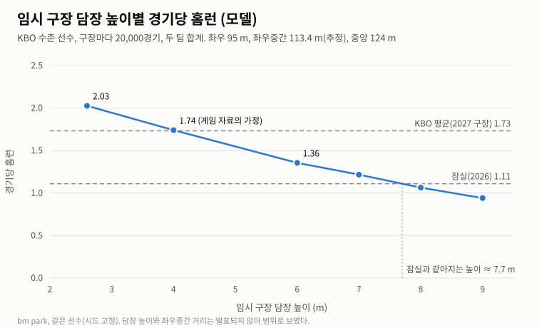

# 시나리오: 잠실 임시 구장에서 홈런은 얼마나 늘까 (2026-11-19)

LG와 두산은 2026 시즌을 끝으로 잠실야구장을 떠나, 2027–2031년에는 같은 종합운동장 안 서울올림픽주경기장에 짓는 임시 구장을 함께 쓴다. 보도된 크기는 좌우 95 m, 중앙 124 m(다른 보도 124.5 m)이고, 짧아진 거리를 메우려 담장을 높인다고 했지만 높이는 발표되지 않았다. 잠실은 좌우 100 m, 좌우중간 120 m, 중앙 125 m, 담장 2.6 m다. 근거는 [`research/world/kbo_clubs.json`](../research/world/kbo_clubs.json)(LG·두산 항목)과 [`research/world/kbo_notes.md`](../research/world/kbo_notes.md)에 있다.

**결론: 임시 구장은 잠실보다 홈런이 훨씬 많다.** 담장이 4 m면 경기당 홈런이 1.11개에서 1.74개(+57%)가 되고, 6 m로 올려도 +22%다. 잠실만큼 홈런을 막으려면 담장이 약 7.7 m여야 한다. 그래도 펜스가 가까워 펜스를 맞는 2루타가 늘어서, 득점은 어떤 높이에서도 잠실보다 6–14% 많다.



## 방법

게임과 같은 엔진·구장 코드로 구장 하나에서만 경기를 치르는 `bm park`를 썼다.

- 선수: KBO 1군 수준(`data/people/levels.json`의 재능, 외국인 선수 포함)으로 만든 10개 구단. 시드가 같으면 모든 구장에서 같은 선수다.
- 구장: 다섯 방위의 펜스 거리와 좌·중·우 담장 높이, 고도(22 m)로 게임의 구장과 똑같이 만든다. 바람과 기온은 없다(모든 구장 같음).
- 구장마다 20,000경기(시드 7). 같은 계산을 시드 11로 다시 해도 잠실 대비 홈런 +56%, 득점 +12%로 시드 7(+57%, +12%)과 같았다.
- 발표되지 않은 값은 범위로 보였다. 담장은 2.6–9 m, 좌우중간은 113.4 m(게임 자료가 거리를 메우는 규칙: 라인에서 중앙까지의 63.5%) 앞뒤로 2 m씩 바꿨다. 게임의 2027 자료는 담장 4.0 m를 가정한다.
- 리그 평균은 2027 게임 자료의 KBO 홈구장 열 곳(두 서울 구단이 함께 쓰는 임시 구장은 두 번)의 평균이다.

## 결과

경기당 수치는 두 팀 합계다. 팩터는 2027 KBO 홈구장 평균(경기당 홈런 1.73, 득점 9.62) = 100.

| 구장 | 경기당 홈런 | 홈런 팩터 | 경기당 득점 | 득점 팩터 | 경기당 2루타 | 경기당 3루타 |
|---|---|---|---|---|---|---|
| 대구 | 2.38 | 137 | 10.50 | 109 | 3.49 | 0.20 |
| 임시 구장, 담장 2.6 m | 2.03 | 117 | 9.80 | 102 | 3.29 | 0.24 |
| 인천 | 1.99 | 115 | 9.82 | 102 | 3.35 | 0.25 |
| 임시 구장, 좌우중간 111.4 m, 담장 4 m | 1.93 | 111 | 9.88 | 103 | 3.53 | 0.26 |
| **임시 구장, 담장 4.0 m(게임 자료)** | **1.74** | **100** | **9.63** | **100** | 3.53 | 0.30 |
| 대전 | 1.71 | 99 | 9.56 | 99 | 3.56 | 0.28 |
| 부산 | 1.68 | 97 | 9.73 | 101 | 3.78 | 0.29 |
| 수원 | 1.57 | 91 | 9.42 | 98 | 3.56 | 0.31 |
| 임시 구장, 좌우중간 115.4 m, 담장 4 m | 1.56 | 90 | 9.35 | 97 | 3.52 | 0.33 |
| 광주 | 1.52 | 88 | 9.12 | 95 | 3.33 | 0.31 |
| 서울 돔(고척, 인조잔디) | 1.52 | 88 | 9.77 | 102 | 3.97 | 0.52 |
| 창원 | 1.46 | 84 | 9.07 | 94 | 3.42 | 0.30 |
| 임시 구장, 담장 6.0 m | 1.36 | 78 | 9.32 | 97 | 3.80 | 0.35 |
| 임시 구장, 담장 7.0 m | 1.22 | 70 | 9.33 | 97 | 3.95 | 0.38 |
| **잠실(2026)** | **1.11** | **64** | **8.60** | **89** | 3.38 | 0.40 |
| 임시 구장, 담장 8.0 m | 1.06 | 61 | 9.14 | 95 | 4.03 | 0.40 |
| 임시 구장, 담장 9.0 m | 0.94 | 54 | 9.16 | 95 | 4.17 | 0.43 |

시즌으로 옮기면(두 구단의 홈경기 144경기) 이 구장에서 나오는 홈런은 잠실 약 160개에서 임시 구장 담장 4 m 약 251개(+91), 2.6 m 약 292개, 6 m 약 195개다. 득점은 약 1,238점에서 1,342–1,412점이 된다.

- 홈런을 가장 크게 움직이는 것은 담장 높이다. 1 m마다 경기당 약 0.14–0.21개가 줄어든다(2.6–9 m).
- 좌우중간 거리도 크다. 2 m 짧으면 홈런이 +11%, 2 m 길면 −10%다(담장 4 m 기준).
- 높은 담장은 홈런을 장타로 바꾼다. 담장 8 m에서 2루타가 경기당 4.03개로 잠실(3.38)보다 많고, 3루타도 담장이 높을수록 늘어난다(2.6 m 0.24개 → 8 m 0.40개, 잠실 0.40개).

## 한계

- **임시 구장의 담장 높이와 좌우중간 거리는 발표되지 않았다.** 그래서 결론은 범위로 읽어야 한다.
- **KBO 구장 팩터를 실측과 비교하지 못했다.** 공개된 구장별 홈런 자료를 찾지 못했다(스탯티즈 같은 기록 사이트는 이용 조건과 이 환경의 접근 제한으로 쓰지 않았다). 순서(대구가 가장 홈런 친화, 잠실이 가장 억제)는 알려진 평판과 맞지만, 크기는 확인하지 않은 모델 값이다. 비거리별 홈런 판정 자체는 MLB 30개 구장의 Statcast 타구에서 맞춤 없이 맞는다([`physics-model.md`](../physics-model.md) 7절).
- 바람·기온이 없다. 경기장(주경기장) 안에 지은 구장의 바람은 다를 수 있다.
- 선수는 KBO 평균 수준의 가상 선수다. 실제 LG·두산 타자의 타구 성향(당겨 치는 정도, 발사각)에 따라 크기가 달라진다. 구단이 구장에 맞춰 선수 구성을 바꾸는 효과는 없다.
- 엔진의 알려진 차이(땅볼이 많고, 15–25° 강한 타구의 홈런이 많고 40–50°는 적음)는 모든 구장에 같이 들어간다.

## 다시 계산하기

```text
cargo build --release -p bm-cli
python3 tools/scenarios/jamsil_park.py target/release/bm OUTDIR   # 구장 19개 × 20,000경기, 4스레드로 약 15분
target/release/bm park --level kbo --fence 95,113.4,124,113.4,95 --wall 4 --elevation 22 --games 20000 --seed 7
```

출처: 서울시 미디어허브(2024-07-09, 임시 구장 좌석), 서울신문(2026-07-15, 좌우 95 m·중앙 124 m), KBO 공지(2026), 나무위키·위키백과(잠실 크기·담장) — 링크는 [`research/world/kbo_clubs.json`](../research/world/kbo_clubs.json)의 LG·두산 항목.
